# EdgeFit AI

**Will this AI model run well on *your* phone? EdgeFit AI answers with measurements, not guesses — Meta Muse Spark predicts on-device inference speed, the phone measures it, and every claim stays traceable to evidence.**

Built for the **2026 Meta Global AI Developer Hackathon**.

> **Status snapshot (2026-11-01):** on-device benchmark + prediction sessions are implemented and physically demonstrated on a Galaxy S22 Ultra; the **Global Evidence backend is deployed and the public dashboard is live** (honestly empty — zero genuine publications yet). No demo-video link is published yet. No signed public APK exists yet. See [Limitations](#p-limitations-known-issues-and-roadmap).

| Access | Link |
|---|---|
| 🌐 Global evidence dashboard (live, empty state) | [edgefit-ai.pages.dev/dashboard.html](https://edgefit-ai.pages.dev/dashboard.html) |
| 📸 Product screenshot gallery | [Gallery](#c-product-screenshot-gallery) · [provenance](docs/screenshot-gallery.md) |
| 🎬 Demo video | Coming soon — no link published yet |
| 📦 APK download | Pending signed public-preview gates ([status](docs/release-readiness.md)) |

## A. Why Android? Hardware fragmentation is the problem

Android devices vary enormously in CPU, core count, RAM, storage, and thermal characteristics. A model that performs well on one Android configuration may be slow, throttled, or unloadable on another — and nothing in the model file tells you which. Vendors publish no per-device inference numbers.

EdgeFit AI profiles hardware, recommends candidate on-device LLMs, predicts performance, measures native inference, and preserves qualified evidence — turning each phone into its own measurement lab. One honest measurement on your hardware beats a hundred generic estimates.

## B. Problem and solution

- **Problem:** choosing an on-device LLM config (model × context × threads × tokens) is guesswork; generic benchmarks don't transfer across the Android hardware zoo.
- **Solution:** profile → recommend → predict → authorize → benchmark → compare → retain → contribute. Each step is explicit, authorized, and evidence-bound; nothing uploads silently, nothing measures silently.

## C. Product screenshot gallery

Genuine captures from a Galaxy S22 Ultra (SM-S908U, Android 16), EdgeFit AI 0.2.0. No mockups. Full gallery with provenance: [docs/screenshot-gallery.md](docs/screenshot-gallery.md).

| Screen | Capture |
|---|---|
| Home dashboard: device card, live telemetry, staged model, last measurement | 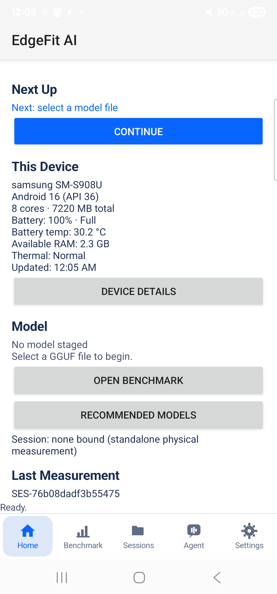 |
| Device Details (live): specs plus live battery, thermal, memory | 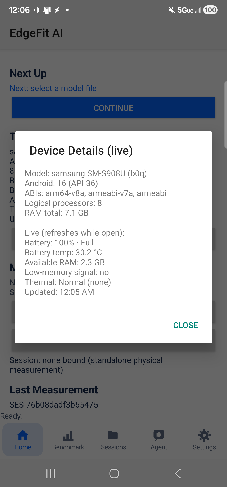 |
| Benchmark setup: model, configuration, evidence-sharing steps | 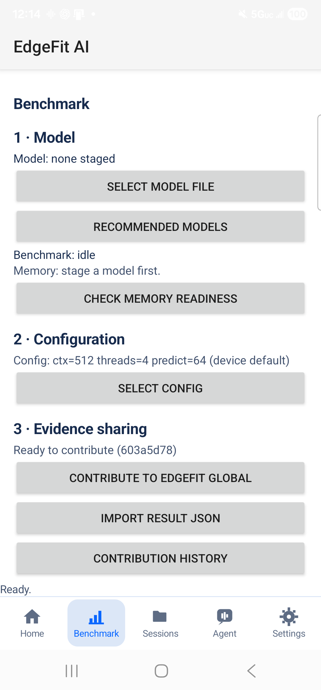 |
| Benchmark tab: config line, memory readiness, Run Benchmark | 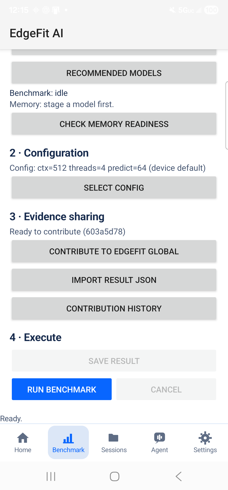 |
| Completed run: 64/64 tokens, measured 15.3 tok/s with chart | 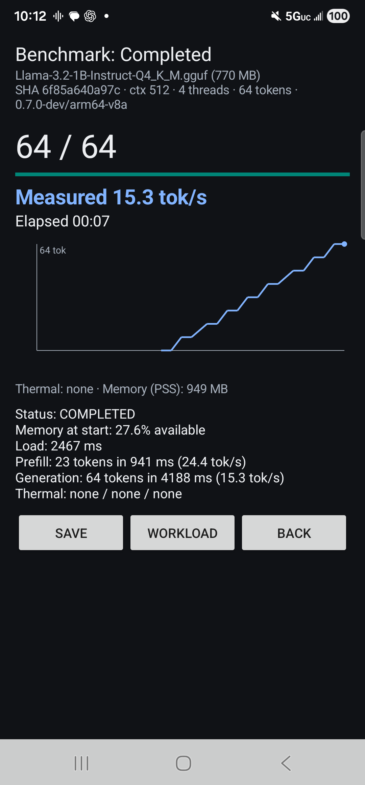 |
| Sessions ledger: durable prediction → benchmark records | 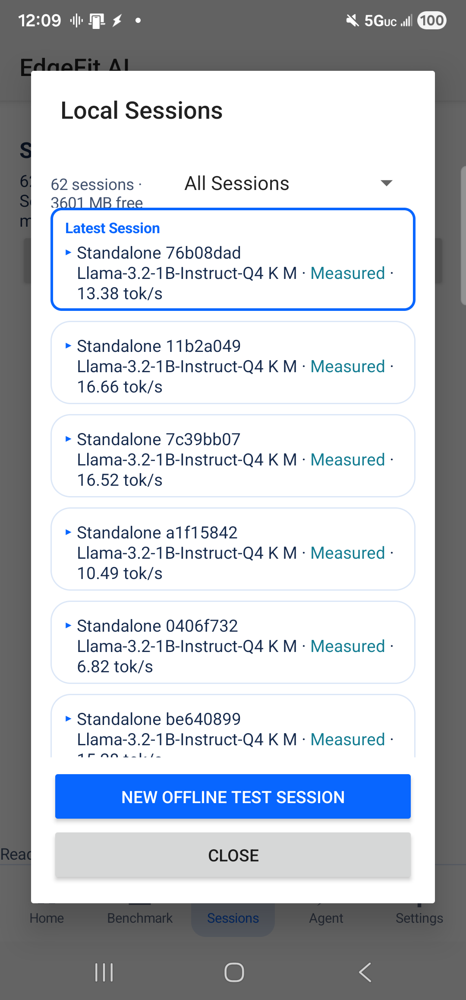 |
| Agent tab: bounded optimization with explicit approvals | 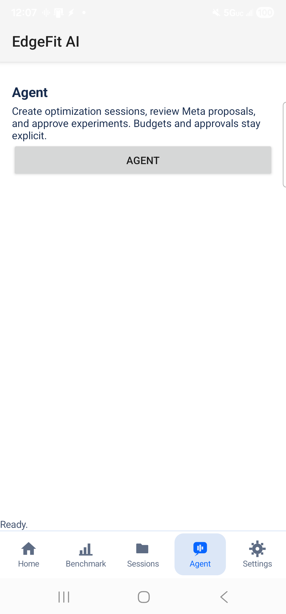 |
| Meta API settings: session-only key custody, explicit authorization | 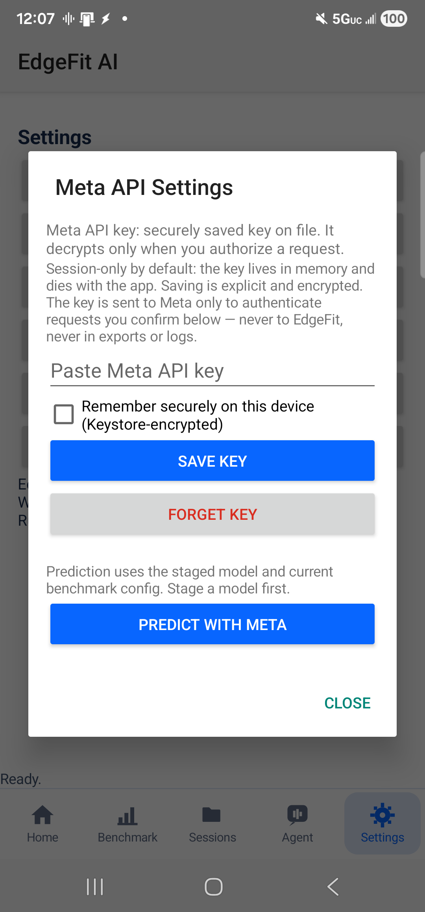 |
| Recommended models: measured values vs unverified estimates | 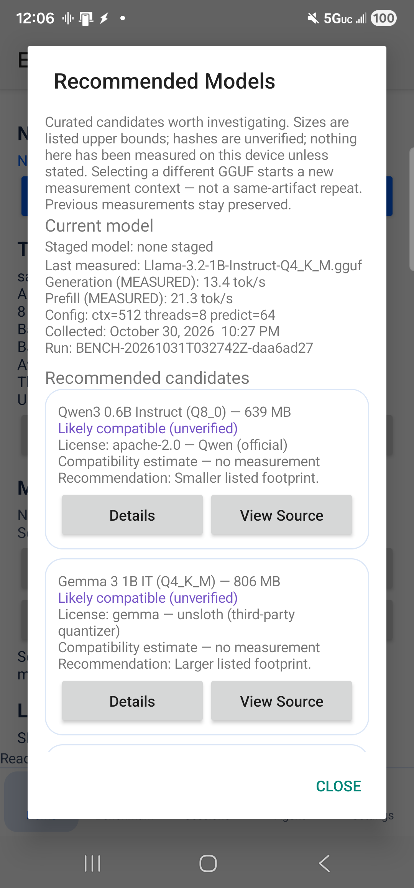 |
| Contribute review: run provenance with consent scope | 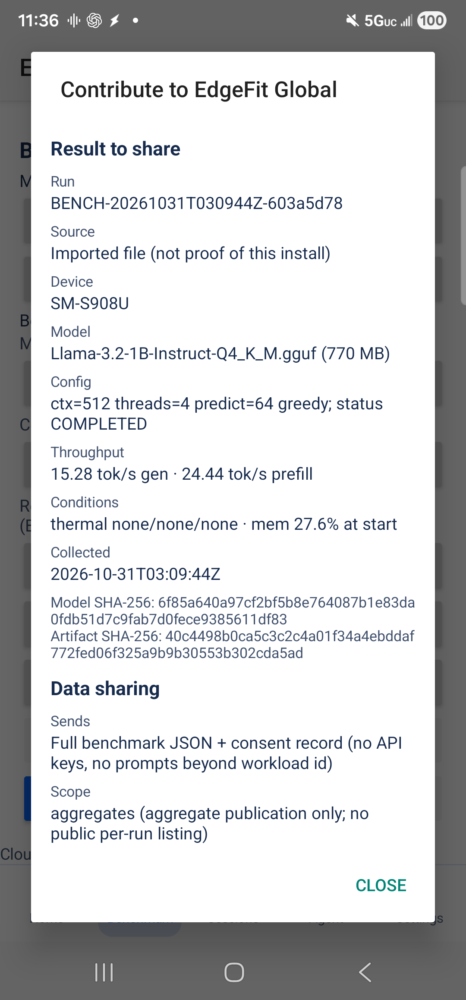 |
| Settings: workload, export, diagnostics, Global connection, build | 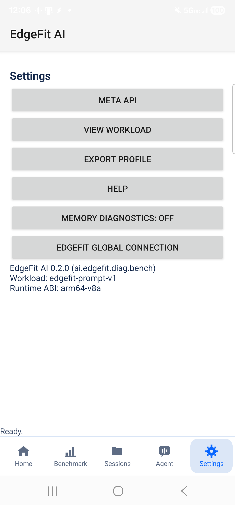 |

## D. Model recommendations

A major EdgeFit feature: the offline GGUF catalog recommends candidate models for *your measured hardware* — weighing compatibility (ABI, runtime), model size against device RAM/storage constraints, and estimated performance with explicit uncertainty. Every card carries provenance (catalog version, source) and states what is known vs guessed.

Crucially, the UI separates **offline catalog recommendations** from **verified physical benchmarks**: compatibility guesses are labeled ESTIMATED / unverified until a real benchmark exists, and measured values are never pooled with estimates. Not every recommended model has been physically benchmarked — the app tells you exactly which have. See [the recommendations capture](assets/screenshots/model-recommendations.png) and [evidence showcase](docs/evidence-showcase.md).

## E. How EdgeFit works

```
profile → recommend → predict → authorize → benchmark → compare → retain → contribute
```

1. **Profile** — platform-reported specs (model, CPU, RAM, ABI, API level) collected on-device; no permissions, no network.
2. **Recommend** — offline catalog suggests GGUF models with explicit unverified estimates.
3. **Predict** — Muse Spark predicts throughput from device + model + config + bounded prior evidence.
4. **Authorize** — every paid or executing step shows what will be sent and costs; nothing auto-runs.
5. **Benchmark** — real llama.cpp inference on the phone; load, prefill, generation tok/s with thermal/memory conditions per run.
6. **Compare** — host computes predicted-vs-measured error deterministically from persisted records.
7. **Retain** — sessions persist in the on-device ledger; exports are contract-v1 JSON; workstation SQLite keeps additive history.
8. **Contribute** — consent-gated per-submission review uploads to the deployed Global backend (client ready; first genuine upload not yet run).

## F. Meta AI capabilities

Three distinct roles, each independently validated by host checks:

- **Muse Code (development):** assisted the 634-test JVM harness, Python contract suites, agent-review engine, and study scaffolding — every milestone test-gated and host-verified.
- **Muse Spark (runtime):** `muse-spark-1.3` via `https://api.meta.ai/v1/responses`, behind explicit authorization: (1) throughput prediction with uncertainty, stored *before* the benchmark; (2) grounded follow-up citing run ids only; (3) bounded agent proposals (5-attempt budget), each locally reviewed (SUPPORTED / CAUTION / INVALID) with no mandatory second paid call.
- **Host validators (trusted boundary):** the model proposes; the host validates, authorizes, executes, and scores. Workstation dispatchers validate tool arguments against a fixed schema *before* any database access — one fixed parameterized read-only query, deterministic order, bounded limit. Model input never becomes SQL. Invalid proposals are blocked fail-closed at zero budget cost. Evidence conditions inference in-context; weights are never updated.

**Model limitations (observed):** in the six-run study both Muse arms correctly **abstained** rather than guess beyond the evidence (fabricated-citation rate 0.0). Abstention is a correct answer, never a failed selection.

Details: [docs/muse-integration.md](docs/muse-integration.md).

## G. Scientific methodology and measured findings

Headline (exploratory, n=3/config, one device): candidate A (4 threads) median **16.52 tok/s**; candidate B (8 threads) median **10.49 tok/s** — more threads measured *slower* on this device/workload. Prediction-before-measurement ordering enforced by timestamp; frozen SHA-256 evidence manifests; per-run thermal/memory conditions; host-computed errors; single-device honesty throughout.

Full claim→artifact map: [docs/evidence-showcase.md](docs/evidence-showcase.md). Results: [docs/validation-results.md](docs/validation-results.md). Method: [docs/evidence-methodology.md](docs/evidence-methodology.md).

## H. Test harness and engineering achievements

- **Android JVM:** 634/634 PASS (sessions, agent review, memory policy, onboarding, catalog, eval arms).
- **Python offline suites** (stdlib only, isolated temp DBs): data, bench, meta, loop, session parity — all green.
- **This branch's cloud foundation:** 38/38 PASS (isolated in-memory DBs, synthetic fixtures only).
- **Deployed backend** (Muse B branch @ `cba27c3`, independently re-run from archive): **297/297 PASS**.
- **Website:** 58/58 + 12/12 + 5/5 PASS per website-workstream reports (not re-run here — no test files on the website branch).
- **PowerShell validators:** EF-META-04 12/12; science + safe-install suites green.
- **Study tooling:** frozen corpus manifests, pre-registered protocols, source-backed scoring.
- Native llama.cpp v0.7.0 pinned + reviewed; ownership test guards the JNI boundary.

Re-run everything offline: [Local development](#o-local-development-and-reproducible-tests).

## I. Global Evidence System (deployed, honestly empty)

The Global backend is **deployed on Cloudflare Free** (three Workers + one D1 database) and the public dashboard is **live**:

| Service | URL | Role |
|---|---|---|
| 📊 Dashboard | [edgefit-ai.pages.dev/dashboard.html](https://edgefit-ai.pages.dev/dashboard.html) | Public evidence dashboard (empty state) |
| 📖 Public reader | `edgefit-evidence-public.ronbaute92.workers.dev` | Anonymous GET-only aggregates/models |
| 📥 Ingest gateway | `edgefit-evidence-ingest-demo.ronbaute92.workers.dev` | Per-install authenticated uploads |

**Architecture:** phone benchmark → explicit per-batch consent → per-install bearer auth → ingest gateway → validation → server-assigned origin → D1 → scheduled qualification (10-row cron) → exact-cohort quorum → publication allowlist → public reader → dashboard. Staging internals stay nonpublic; the public reader enforces a 120/60s rate limit.

**Methodology:** a cohort matches exactly on device class, model SHA-256, quantization, runtime, workload + prompt identity, context, threads, tokens, sampler, optimization, and build provenance. Publication needs **≥5 eligible runs from ≥3 distinct installs in the same exact cohort** — SM-S908U and SM-S906U are different cohorts, never pooled. Installs ≠ attested devices. Synthetic/legacy rows are permanently ineligible.

**Current status (2026-11-01): zero genuine publications.** 19 legacy/synthetic test rows, 0 `device_contribution` rows, empty allowlist, consent `ef-consent-01` PROPOSED not approved, first genuine upload (P0) not run. The dashboard's empty charts and `artifacts:[]` API responses are the *correct* output — nothing estimated, nothing filled in.

**Independently verified by this workstream:** dashboard 200 with honest empty copy; `/v1/models` → `artifacts:[]`; ingest `GET /v1/models` → 404 (narrow routing intact); backend suite 297/297 re-run from the pinned-commit archive; rate-limit (120) and scheduler ceiling (10) confirmed in source. D1 census and 401 behavior attributed to Muse B's dated handoff (`cba27c3`).

## J. Download / install / requirements

**No signed public APK exists yet** — current builds are debuggable owner-testing images and are explicitly not release candidates. Do not distribute them. When the `public-preview` build passes its gates, it will appear as a GitHub Release with SHA-256 + signing fingerprint. Gate tracker: [docs/release-readiness.md](docs/release-readiness.md).

Build-from-source requirements: Android Studio (AGP 8.7.3, compileSdk 35), NDK, llama.cpp v0.7.0 (see [docs/bench-build.md](docs/bench-build.md)), a physical arm64-v8a device (minSdk 26), and a user-provided GGUF model file (the app never downloads models). First sync needs network.

## K. Why Google Play distribution is pending

No store listing exists because there is no signed release candidate, and the hackathon window does not fit the store timeline (policy review, data safety, rollout — plus, for personal accounts created after Nov 13 2023, a 12-tester / 14-day closed test before applying for production access). Direct GitHub distribution is the planned preview channel. Full note: [docs/play-distribution-note.md](docs/play-distribution-note.md).

## L. Architecture diagram and technical stack

```mermaid
flowchart LR
    Phone["Android app\n(benchmark + sessions + BYOK)"]
    JSON["Contract-v1 JSON\nexport / import"]
    SQLite["Workstation SQLite\n(private evidence store)"]
    Muse["Meta Muse Spark\n(predict + follow-up)"]
    Cloud["Global backend + dashboard\n(DEPLOYED, honestly empty)"]

    Phone -->|"explicit export,\nno auto-upload"| JSON
    JSON -->|"two-flag commit\nimport"| SQLite
    SQLite -->|"bounded validated\nretrieval"| Muse
    Muse -->|"prediction recorded\nbefore measurement"| Phone
    Phone -.->|"consent-gated upload\n(deployed; first\n genuine upload pending)| Cloud
```

Stack: Kotlin + JNI (llama.cpp v0.7.0, CPU), programmatic Views + Aero design system, app-private JSON ledger, Python stdlib workstation tooling, Cloudflare Workers + D1 (zero-dependency JS) Global backend.

Deeper reference: [docs/architecture.md](docs/architecture.md) and the authoritative [docs/edgefit-master-architecture.md](docs/edgefit-master-architecture.md). Decisions: [docs/edgefit-architecture-decisions.md](docs/edgefit-architecture-decisions.md). Traceability: [docs/ef-arch-02-traceability.md](docs/ef-arch-02-traceability.md).

## M. Evidence and qualification documentation

- [docs/evidence-showcase.md](docs/evidence-showcase.md) — claim → artifact map
- [docs/validation-results.md](docs/validation-results.md) — measured results with caveats
- [docs/qualification-status.md](docs/qualification-status.md) — full qualification record
- [docs/evidence-methodology.md](docs/evidence-methodology.md) — provenance and eligibility
- [docs/ef-repo-judge-01-feature-matrix.md](docs/ef-repo-judge-01-feature-matrix.md) — 28-feature audit
- [`eval/comp-01b/`](eval/comp-01b/) — frozen six-run study corpus

## N. Reproduction instructions

**Harness (physical):** open `android/` in Android Studio and sync; fetch llama.cpp v0.7.0 into `android/third_party/llama.cpp`; build `benchmark`; install on a physical device; stage a GGUF in-app; run from the Benchmark tab; export contract-v1 JSON via the system picker; validate on the workstation (`py -3 scripts/ef_bench_result_01.py <file>`). Full procedure: [docs/device-testing.md](docs/device-testing.md).

**Offline suites (no device, no network, no credentials):** [Local development](#o-local-development-and-reproducible-tests).

**Study:** frozen corpus + runbook reproduce the six-run analysis without re-running the phone: [docs/ef-comp-01b-owner-run.md](docs/ef-comp-01b-owner-run.md).

**Global backend:** fetch `implement/ef-global-01-2026-10-30` @ `cba27c3`, extract `cloud/`, `npm test` (297 tests, isolated DBs).

## O. Local development and reproducible tests

Prerequisites: Python 3 (stdlib only), Node 24+ (cloud tests), PowerShell (validator tests). No credentials needed for any offline suite.

```powershell
# Python offline suites (no network, isolated temp databases)
py -3 .\scripts\ef_data_01.py
py -3 .\scripts\test_ef_meta_05.py
py -3 .\scripts\test_ef_android_01.py
py -3 .\scripts\test_ef_data_02.py
py -3 .\scripts\test_ef_bench_01.py
py -3 .\scripts\test_ef_data_03.py
py -3 .\scripts\test_ef_meta_06.py
py -3 .\scripts\test_ef_loop_01.py

# PowerShell validator suites (no Meta API usage)
.\scripts\Test-EF-META-04.ps1
powershell -ExecutionPolicy Bypass -File .\scripts\Test-EFScience01A.ps1

# Cloud foundation tests (isolated in-memory databases)
npm test --prefix cloud

# Study manifest regression
node .\scripts\ef-comp-01a-manifest.test.mjs
```

Live Meta round trips are owner-executed only, require `MODEL_API_KEY`, and never run in tests or CI. Guide: [docs/quickstart.md](docs/quickstart.md).

## P. Limitations, known issues and roadmap

- Physical evidence comes from **one device** (Galaxy S22 Ultra) with small samples (1–3 runs per config): all comparisons are **exploratory**, not confirmatory.
- Device-profile collection is **not** inference benchmarking; only COMPLETED bench runs count as measurements.
- The one live BYOK session, one agent loop, and six-run study are scoped demonstrations — see [qualification-status](docs/qualification-status.md).
- Global backend + dashboard are **deployed but empty**: zero genuine uploads, zero published cohorts, consent unapproved, P0–P3 not run. No multi-device data exists.
- No signed public release yet ([gates](docs/release-readiness.md)); no Play listing ([note](docs/play-distribution-note.md)).
- On Nov 1 the study phone's benchmark package was removed by an unattributed actor and a fresh base build installed (later INSTALL-07 recovery reported PASS on the S22); workstation evidence is intact; governed by mandatory safe-install preflight ([ef-safe-install-01](docs/ef-safe-install-01.md)).
- Roadmap: public-preview APK → first genuine uploads + quorum → Play publication. Proposed-only: none remaining in the showcase — the explorer is deployed.

## Q. Hackathon information and original-work scope

Built for the **2026 Meta Global AI Developer Hackathon** (deadline Nov 4, 2026). Original work: Android harness + Aero UI, session/agent/consent architecture, cloud foundation + deployed Global backend, dashboard website, study design + frozen corpus, and all documentation. Pinned third-party code: llama.cpp v0.7.0 (reviewed, ownership-tested). Meta Muse Spark (`muse-spark-1.3`) used via API for predictions, follow-ups, and agent proposals; Muse Code assisted test-harness and scaffolding development. No license file is published yet; until one is added, no reuse rights are granted. (Owner action: approve and add `LICENSE`.)

## R. Video and verified submission links

**Demo video coming soon.** No video link is published yet; this section will be updated with the verified URL. A scripted walkthrough is ready in [docs/demo.md](docs/demo.md).

Verified links: this repository, the [live dashboard](https://edgefit-ai.pages.dev/dashboard.html), and the public read API above. No download or video URL is claimed anywhere in this README beyond what exists.
