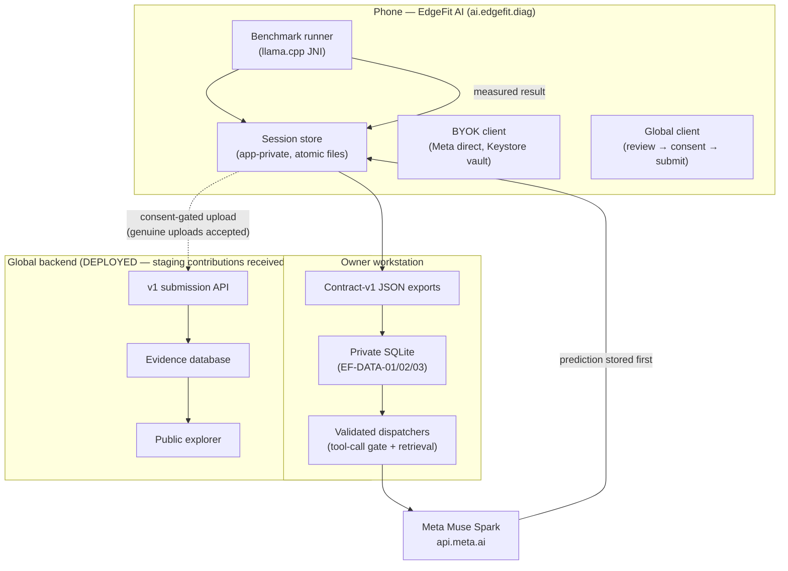

# Architecture

Judge-facing system map. Authoritative reference:
[edgefit-master-architecture.md](edgefit-master-architecture.md) — nothing
here weakens it.

## System map

## Component status

| Component | Status | Evidence |
|---|---|---|
| Device profiler + benchmark app | Implemented, physically demonstrated (S22 Ultra) | [device-testing.md](device-testing.md), [validation-results.md](validation-results.md) |
| Session store (EF-SESSION-01) | Host + scoped physical pass | [qualification-status.md](qualification-status.md) |
| BYOK prediction/follow-up (EF-BYOK-01) | Host + one live session | [muse-integration.md](muse-integration.md) |
| Bounded agent loop (EF-AGENT-01) | Host + one scoped live loop | [edgefit-agentic-workflow.md](edgefit-agentic-workflow.md) |
| Workstation SQLite + importers | Qualified (additive migrations 2, 3) | [ef-data-02-import.md](ef-data-02-import.md), [ef-data-03-bench.md](ef-data-03-bench.md) |
| Validated retrieval + dispatch | Offline + live qualified | [muse-integration.md](muse-integration.md) |
| Cloud backend | **Deployed** (3 Workers + D1), 297/297 PASS @ `cba27c3`, 36 accepted staging contributions, 0 published, gate closed (API 2026-11-04) | [README global section](../README.md#i-global-evidence-system-deployed-staging-contributions-received-no-qualified-public-cohorts-published) |
| Global contribution client | Host-qualified; backend live, genuine uploads accepted (3 installs, ef-consent-01) | [ef-global-contribute-app-handoff.md](ef-global-contribute-app-handoff.md) |
| Public dashboard | **Live** (staging counts visible; zero public cohorts) ([dashboard](https://edgefit-ai.pages.dev/dashboard.html)) | Handoff `cba27c3` §H |
| Signed public release | v0.2.1-preview.1 published; signed-release physical-install test not yet verified | [edgefit-release-and-distribution.md](edgefit-release-and-distribution.md) |

## Key design rules

- **Explicit action only.** No background upload, no silent inference, no
  auto-execution: every network call and every benchmark answers one tap.
- **Prediction before measurement.** Estimates are persisted first; error is
  computed deterministically by the host.
- **Fixed, validated retrieval.** The model gets bounded evidence through an
  allowlisted dispatcher; model input never becomes SQL.
- **Provenance everywhere.** Model SHA-256, workload id, config hash, run id,
  and collection conditions travel with every number.
- **Consent-gated sharing.** Aggregate vs per-run disclosure are independent
  scopes; per-run listing stays disabled until its policy is approved.
- **Phone-push only.** No cloud-to-phone sync, no inbound connections, no
  remote wipe.

## Repository layout

| Path | Contents |
|---|---|
| `android/` | App sources, JNI bridge, resources, JVM tests |
| `scripts/` | SQLite fixtures, importers, retrieval, dispatchers, offline tests |
| `cloud/` | Backend foundation (API, validation, qualification, stats) + tests |
| `docs/` | Architecture, contracts, procedures, qualification record |
| `eval/` | Frozen study corpora, manifests, decisions, run evidence |
| `data/` | Owner-local SQLite (gitignored; only `.gitkeep` is tracked) |
| `assets/screenshots/` | Genuine device captures used by the README |
